# NEXUS_PFE — Multimodal Contactless Health Screening + Federated Learning

**A privacy-preserving, multimodal health-screening platform** that runs the same
AI pipeline — dermatology, ocular (eye), and contactless vital signs (rPPG) — across
a desktop web app, a native mobile app, and a Raspberry Pi 5 edge device, and
improves its models over time via **federated learning** without ever centralizing
a single patient image.

This repository is the umbrella for the final-year engineering thesis (*Projet de
Fin d'Études*) project **NEXUS_PFE**, made up of four sub-projects:

| Sub-project | What it is | Platform |
|---|---|---|
| [`nexus_pfe/`](nexus_pfe/) | Phase 1 — desktop validation bench (Streamlit UI) + FL client | Ubuntu / Windows / Python |
| [`nexus_pfe_mobile/`](nexus_pfe_mobile/) | Phase 2 — native on-device app | Flutter (Android, iOS-ready) |
| [`nexus_pfe_raspberrypi/`](nexus_pfe_raspberrypi/) | Phase 2 — edge deployment + FL client | Raspberry Pi 5 (ARM64) |
| [`nexus_pfe_server_fed/`](nexus_pfe_server_fed/) | Federated learning **server** (FedAvg aggregation) | Windows / Python |

```
Desktop / Ubuntu (nexus_pfe)  ─┐
Raspberry Pi 5 (nexus_pfe_raspberrypi) ─┼──► nexus_pfe_server_fed (FedAvg server)
Flutter mobile (nexus_pfe_mobile, status-only) ─┘
```

> ⚠️ **Disclaimer**: This is a research prototype built for a thesis appendix.
> It is **not a certified medical device**. All predictions (dermatology, ocular,
> BPM/HRV) are estimates only and must never be used for clinical decisions.

---

## Table of contents

- [Overview](#overview)
- [Architecture](#architecture)
- [Key features](#key-features)
- [Screenshots](#screenshots)
- [The three screening modules](#the-three-screening-modules)
- [Federated learning](#federated-learning)
- [Results & benchmarks](#results--benchmarks)
- [Getting started](#getting-started)
- [Tech stack](#tech-stack)
- [Repository structure](#repository-structure)
- [Model status](#model-status)
- [Licensing & acknowledgments](#licensing--acknowledgments)

---

## Overview

NEXUS_PFE screens for three things from a camera, with **no cloud inference call**
on any platform:

1. **Ocular disease** — classifies a photo of an eye (Cataract, Conjunctivitis,
   Eyelid disorder, Uveitis, Normal).
2. **Dermatology** — classifies a photo of skin across 10 curated non-cancerous
   conditions + normal.
3. **rPPG (remote photoplethysmography)** — estimates heart rate (BPM) and heart-rate
   variability (SDNN, RMSSD) from a live face video, with no contact sensor.

The same ONNX models and the same preprocessing run **identically** on a desktop
browser (Streamlit), a Raspberry Pi 5, and a Flutter mobile app — proving the
pipeline is portable before anything touches embedded/mobile hardware. A fourth,
cross-cutting piece — **federated learning** — lets the dermatology and ocular
models keep improving from data on the desktop machine and the Raspberry Pi 5
*without either device ever sending a raw image anywhere*: only model weight
arrays are exchanged with the FL server, which aggregates them with FedAvg.

## Architecture

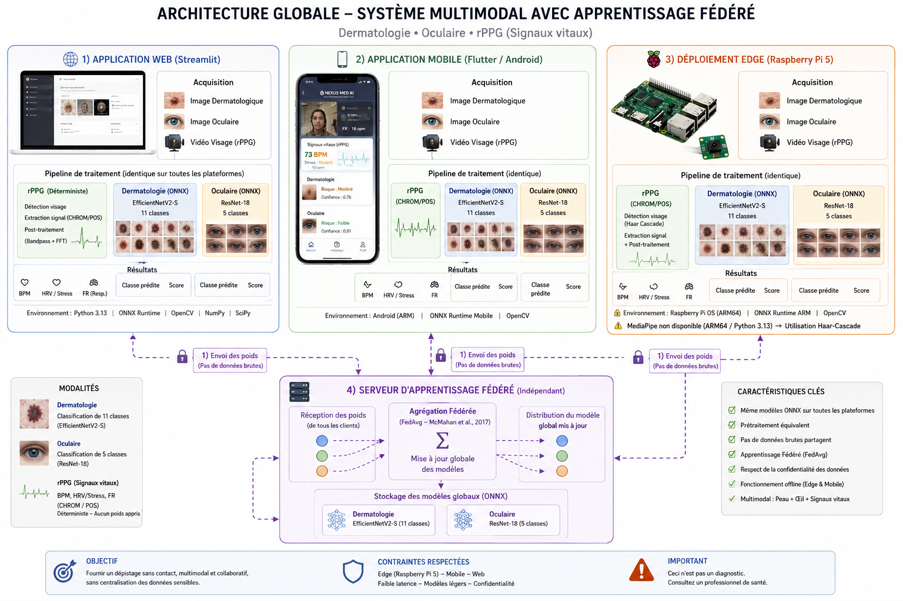

*End-to-end view: three identical inference stacks (web, mobile, edge) feeding a
shared, framework-agnostic federated learning server. Only model weights ever
cross the dashed lines — never a raw image.*

<details>
<summary>Alternate architecture diagram (repo-level view)</summary>

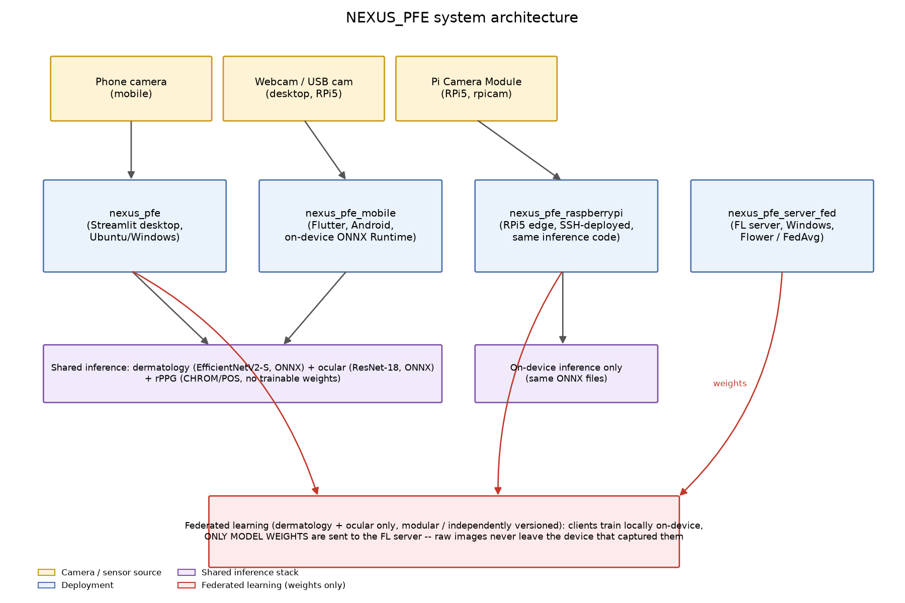

</details>

**How a federated round flows, end to end:**

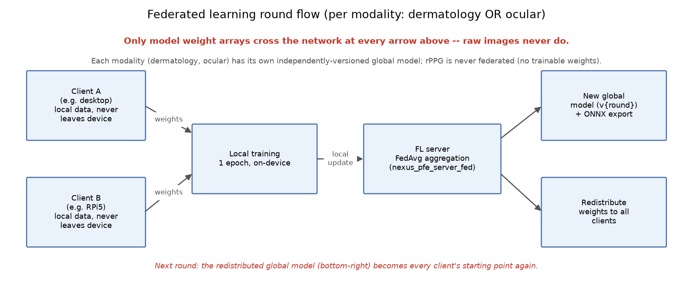

Each client trains locally (1 epoch, on-device, on a small seeded non-IID data
shard) and sends only its resulting weight arrays to the FL server. The server
FedAvg-aggregates every client's update, evaluates the new global model on its
own held-out test set, versions it (`global_v{round}`), re-exports it to ONNX,
and redistributes it — the redistributed model becomes every client's starting
point for the next round.

## Key features

- ✅ **Same ONNX models everywhere** — dermatology (EfficientNetV2-S) and ocular
  (ResNet-18) run through ONNX Runtime on desktop, mobile, and edge, with
  matching preprocessing verified cross-platform (see [prediction agreement](#results--benchmarks)).
- ✅ **Fully offline inference** — no network call is ever made for a
  prediction, on any platform.
- ✅ **Federated learning, not centralized training** — raw images never leave
  the device that captured them; only weight updates cross the network
  (McMahan et al.'s FedAvg).
- ✅ **Multi-framework FL** — dermatology (TensorFlow/Keras) and ocular
  (PyTorch) are federated independently through one framework-agnostic server
  contract, with no cross-framework weight conversion.
- ✅ **Deterministic rPPG** — CHROM & POS chrominance-based algorithms
  (no trainable weights, never federated) extract BPM/HRV from a webcam or
  phone camera feed.
- ✅ **Camera-source abstraction on the edge** — the Raspberry Pi 5 build runs
  the exact same inference code against a USB webcam, an IP camera, or the
  Pi Camera Module, with an automatic MediaPipe → OpenCV Haar-cascade fallback
  for face detection (MediaPipe has no ARM64/Python 3.13 wheel).
- ✅ **Honest about what's simulated** — the mobile app cannot realistically
  train EfficientNetV2-S/ResNet-18 on-device, so its "Apprentissage fédéré"
  screen shows the FL server's *real* round history and hands the user the
  exact CLI command to run a real training client, instead of faking a
  progress bar.

## Screenshots

### Web app (Streamlit — `nexus_pfe` / `nexus_pfe_raspberrypi`)

| Dermatology | Ocular | rPPG (HRV/BPM) |
|---|---|---|
| 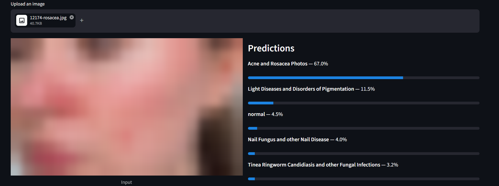 | 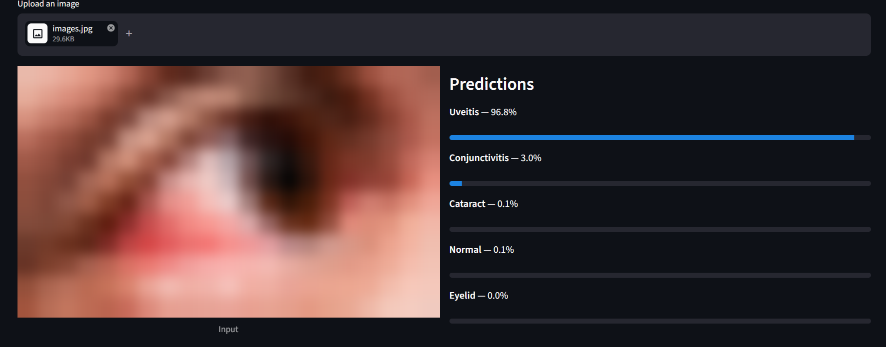 | 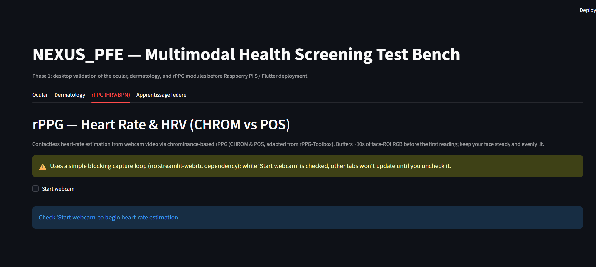 |
| Rosacea correctly identified at 67% confidence, with the full class probability breakdown. | Uveitis identified at 96.8% confidence from an eye photo. | Live webcam CHROM/POS heart-rate tab (shown before "Start webcam" is checked). |

### Mobile app (Flutter — `nexus_pfe_mobile`)

| Home | Ocular capture | rPPG live |
|---|---|---|
| 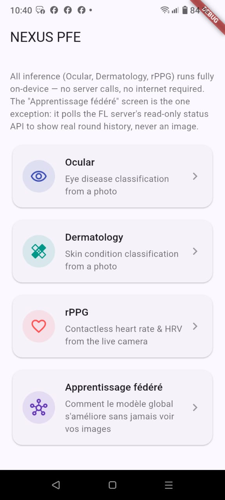 | 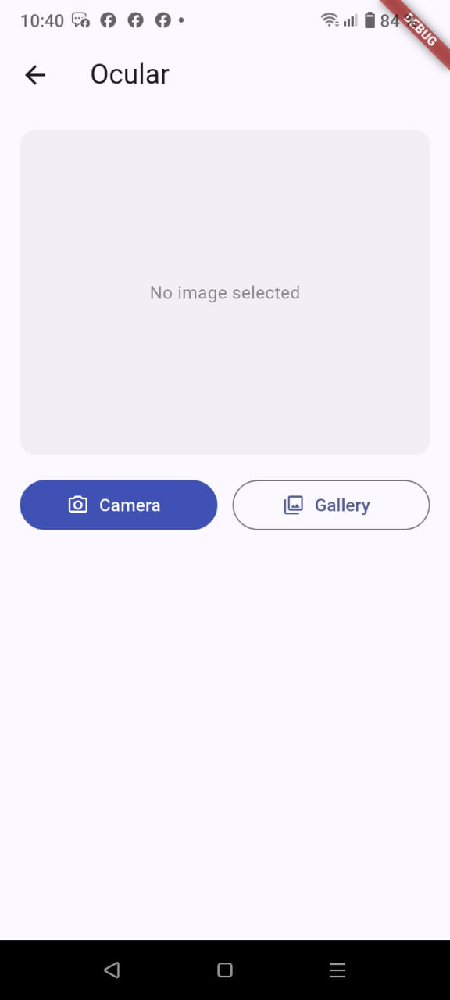 | 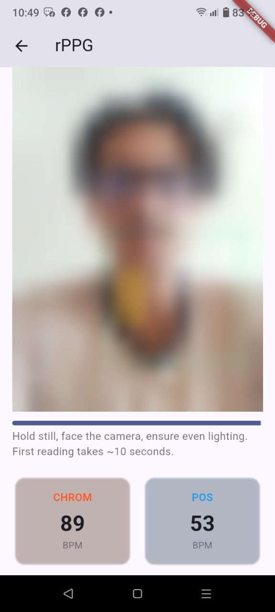 |
| The four on-device modules — all inference is local except the FL status screen. | Camera-or-gallery capture flow for the ocular/dermatology modules. | Live face-ROI tracking with real-time CHROM (89 BPM) vs. POS (53 BPM) readings. |

## The three screening modules

| Module | Model | Input | Output | Classes |
|---|---|---|---|---|
| **Ocular** | ResNet-18 → ONNX (Kaggle-trained) | Eye photo | Condition + confidence | Cataract, Conjunctivitis, Eyelid, Normal, Uveitis (5) |
| **Dermatology** | EfficientNetV2-S → ONNX | Skin photo | Condition + confidence | 10 curated non-cancerous conditions + normal (11) |
| **rPPG** | CHROM & POS (deterministic, adapted from [rPPG-Toolbox](https://github.com/ubicomplab/rPPG-Toolbox)) | Face video (webcam/phone camera) | BPM, HRV (SDNN, RMSSD) | — (no classes, signal processing only) |

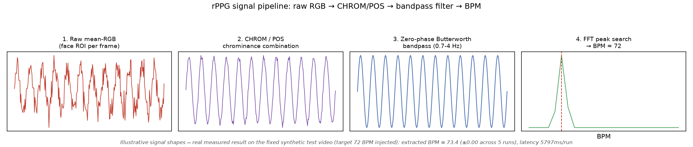

*Raw per-frame face-ROI RGB → CHROM/POS chrominance combination → zero-phase
Butterworth bandpass (0.7–4 Hz) → FFT peak search for BPM. On a fixed synthetic
test clip with a 72 BPM injected pulse, the pipeline recovers 73.4 BPM (±0.00
across 5 runs).*

## Federated learning

`nexus_pfe_server_fed` is the FedAvg aggregation server; `nexus_pfe`'s
`fl_client/` and `nexus_pfe_raspberrypi`'s `fl/` are its two real training
clients (desktop + Raspberry Pi 5). The mobile app does **not** train
on-device — see its README for why — but polls the server's read-only status
API to display real round history.

| Component | Role | Trains? | Sends raw images? |
|---|---|---|---|
| `nexus_pfe_server_fed` | FedAvg server, model versioning, ONNX re-export | No (aggregates only) | Never receives any |
| `nexus_pfe` (`fl_client/`) | Desktop FL client | Yes (TensorFlow + PyTorch) | Never |
| `nexus_pfe_raspberrypi` (`fl/`) | Edge FL client | Yes (TensorFlow + PyTorch) | Never |
| `nexus_pfe_mobile` | Status display only | **No** — hands off the CLI command instead | N/A |

Convergence measured on real held-out data (2 clients, round 0 = pretrained
centralized checkpoint):

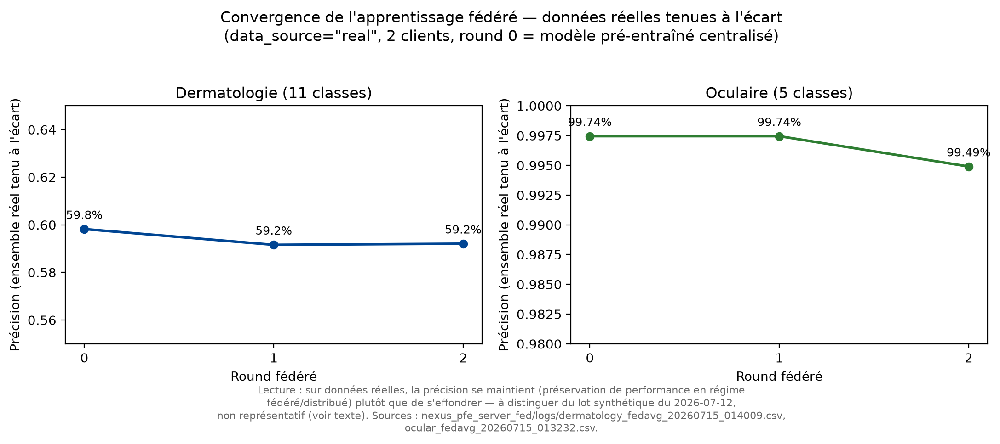

*Dermatology (11 classes) holds steady at ~59% across 3 rounds; ocular
(5 classes) holds at ~99.5–99.7% — both preserve performance under a
federated/distributed regime rather than collapsing, which is the property
this proof of concept set out to demonstrate.*

## Results & benchmarks

### Model accuracy (held-out test sets)

| Dermatology confusion matrix (61.6% accuracy, 11 classes) | Ocular confusion matrix (95.9% accuracy, 5 classes) |
|---|---|
| 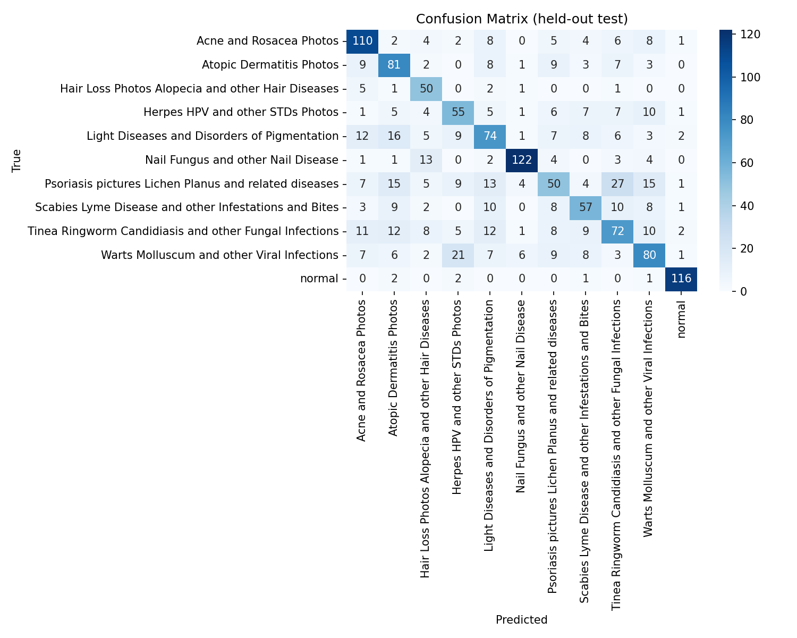 | 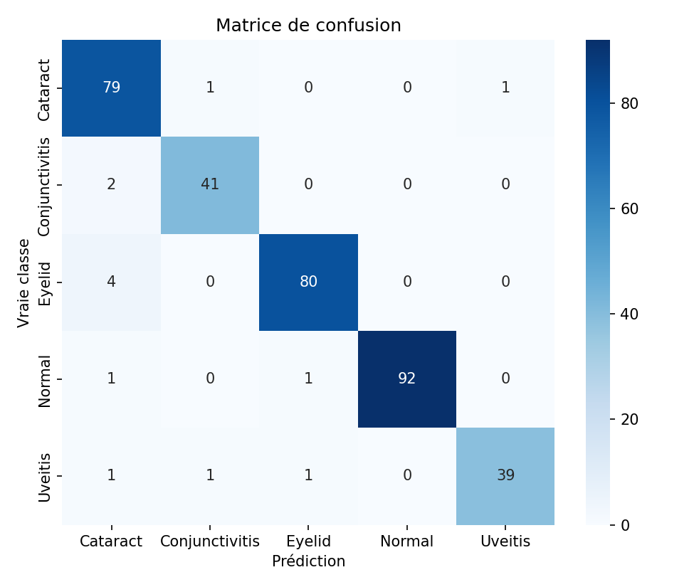 |

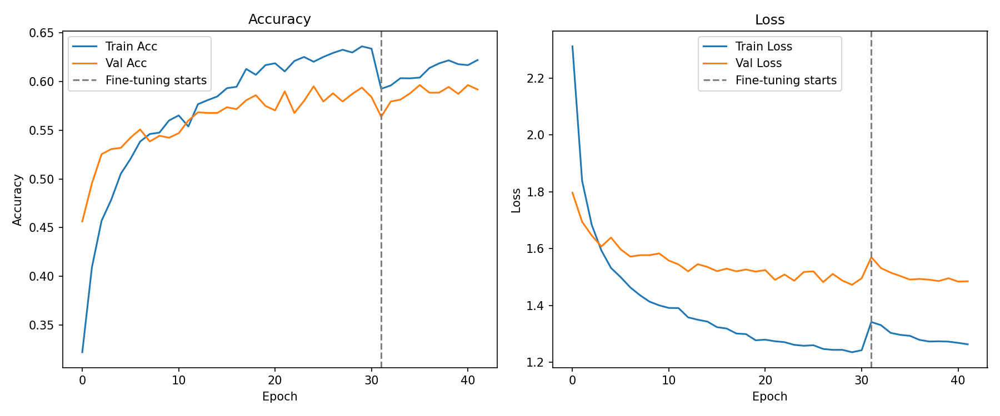

*EfficientNetV2-S, 42 epochs with a fine-tuning phase starting at epoch 31.
Psoriasis is the weakest class, most confused with Tinea/Ringworm/Fungal
infections — see `nexus_pfe/docs/model_cards.md` for the full per-class
breakdown.*

### Cross-platform validation

A core claim of this project is that porting the pipeline to mobile/edge
introduces no silent bugs. Two things were measured to check this:

**1. Latency, memory, and load time across all three platforms** (n=30 timed
runs per platform, 5 warm-up runs discarded):

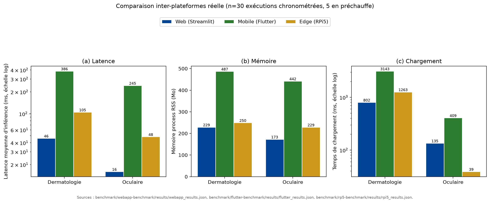

**2. Prediction agreement on identical images across platforms** — the same
test image should get the same prediction on web, mobile, and the Raspberry
Pi 5:

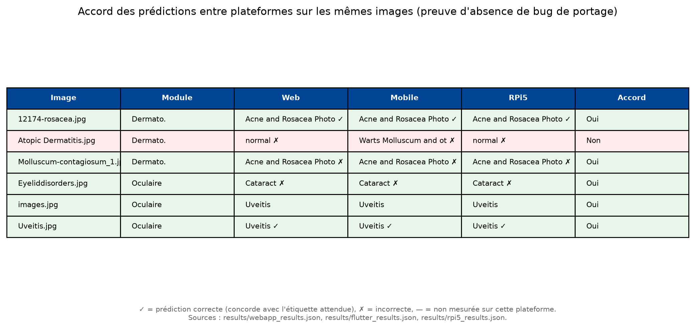

*5 of 6 sampled images agree exactly across all three platforms — direct
evidence against a porting/preprocessing bug on any one platform. The one
disagreement (`Atopic Dermatitis.jpg`) is a genuine model misclassification
(all three platforms disagree with each other, not just one outlier), not a
platform-specific defect.*

## Getting started

> **Models and datasets are not stored in git.** The trained ONNX weights are
> **available on request** (open an issue or contact the author via GitHub);
> once you have them, `scripts/download_models.sh` puts them in place. See
> [DATA.md](DATA.md) and `scripts/download_data.sh` for the datasets needed to
> retrain or evaluate.

Each sub-project is independently runnable and has its own detailed README.
Short version below; **follow the linked README for the full setup**.

### 1. Desktop web app (`nexus_pfe`)

```bash
cd nexus_pfe
python3 -m venv venv
source venv/bin/activate        # Windows: venv\Scripts\activate
pip install -r requirements.txt
streamlit run app.py
```

Opens a local Streamlit UI with four tabs: Ocular, Dermatology, rPPG
(HRV/BPM), and Apprentissage fédéré. See [`nexus_pfe/README.md`](nexus_pfe/README.md).

### 2. Mobile app (`nexus_pfe_mobile`)

```bash
cd nexus_pfe_mobile
flutter pub get
flutter run              # or: flutter build apk
```

Requires Flutter 3.44+/Dart 3.12+ and a physical Android device recommended for
the rPPG module (camera behavior on emulators is unreliable). See
[`nexus_pfe_mobile/README.md`](nexus_pfe_mobile/README.md).

### 3. Raspberry Pi 5 edge deployment (`nexus_pfe_raspberrypi`)

```bash
cd nexus_pfe_raspberrypi
python3 -m venv venv
source venv/bin/activate
pip install -r requirements.txt
streamlit run app.py
```

Full SSH deployment walkthrough (rsync to the Pi, `picamera2` setup, camera
source selection) is in
[`nexus_pfe_raspberrypi/docs/deployment.md`](nexus_pfe_raspberrypi/docs/deployment.md).

### 4. Federated learning server (`nexus_pfe_server_fed`)

```powershell
cd nexus_pfe_server_fed
pip install -r requirements.txt
python -m fl_server.server --model dermatology --port 8080 --min-clients 2 --rounds 5
python -m fl_server.status_api             # read-only status API, port 8090
```

Then, from the desktop machine and/or the Raspberry Pi 5:

```bash
python -m fl_client.client --client-id 0 --server <server-ip>:8080 --model dermatology --num-clients 2
python -m fl_client.client --client-id 1 --server <server-ip>:8080 --model dermatology --num-clients 2
```

Full runbook (firewall rules, finding the LAN IP, placing pretrained
checkpoints, plotting convergence) is in
[`nexus_pfe_server_fed/docs/fl_setup.md`](nexus_pfe_server_fed/docs/fl_setup.md).

## Tech stack

| Layer | Technology |
|---|---|
| Desktop UI | Streamlit |
| Mobile UI | Flutter / Dart |
| On-device inference | ONNX Runtime (desktop, edge), `flutter_onnxruntime` (mobile) |
| Model training | TensorFlow/Keras (dermatology, EfficientNetV2-S), PyTorch (ocular, ResNet-18) |
| Federated learning | [Flower](https://flower.ai/) (FedAvg) |
| Face detection | MediaPipe FaceLandmarker (desktop/mobile), OpenCV Haar cascade fallback (Raspberry Pi 5), ML Kit (Flutter) |
| Signal processing | CHROM & POS (rPPG), SciPy bandpass filtering, FFT-based BPM |
| Edge hardware | Raspberry Pi 5, Pi Camera Module / USB webcam / IP camera |

## Repository structure

```
nexus/
├── README.md                     # you are here
├── arch_global.png                # full-system architecture diagram
├── figures/                       # generated evaluation figures (confusion matrices,
│                                   # learning curves, FL convergence, latency, architecture)
├── Screenshot_app/
│   ├── streamlit/                 # web app screenshots
│   └── Mobile/                    # mobile app screenshots
├── nexus_pfe/                     # Phase 1: desktop Streamlit validation bench + FL client
├── nexus_pfe_mobile/              # Phase 2: Flutter mobile app (on-device inference)
├── nexus_pfe_raspberrypi/         # Phase 2: Raspberry Pi 5 edge deployment + FL client
└── nexus_pfe_server_fed/          # Federated learning server (FedAvg aggregation)
```

## Model status

| Model | Accuracy | Classes | Notes |
|---|---|---|---|
| Ocular (ResNet-18, ONNX) | ~95.9% | 5 | All per-class F1 ≥ 0.93; classes are well-separated. |
| Dermatology (EfficientNetV2-S, ONNX) | ~61.6% | 11 | Precision 0.79 / recall 0.46 (macro); Psoriasis is the weakest class. |
| rPPG (CHROM/POS) | 73.4 BPM recovered vs. 72 BPM injected, synthetic clip | — | Deterministic; not yet benchmarked against a real pulse oximeter — see `nexus_pfe/README.md`'s validation checklist. |

See each sub-project's `docs/model_cards.md` for full per-class precision/recall
breakdowns and known limitations.

## Licensing & acknowledgments

- The rPPG CHROM/POS implementation is adapted from
  [rPPG-Toolbox](https://github.com/ubicomplab/rPPG-Toolbox) (de Haan & Jeanne,
  2013; Wang et al., 2016), released under the Responsible AI License (RAIL) —
  review its license terms before any use beyond academic/research purposes,
  and cite the toolbox's paper in any written deliverable that uses it. The
  Flutter mobile app's rPPG code is an original Dart re-implementation of the
  published CHROM/POS equations, not a port of rPPG-Toolbox source.
- Federated averaging follows McMahan et al., *"Communication-Efficient
  Learning of Deep Networks from Decentralized Data"* (2017), implemented via
  [Flower](https://flower.ai/).
- Datasets are **not** included in this repository. See [DATA.md](DATA.md) for
  the original sources, citations and download instructions.
- rPPG-Toolbox is not vendored; see its upstream
  [LICENSE](https://github.com/ubicomplab/rPPG-Toolbox/blob/main/LICENSE).
- The **source code** is released under the [MIT License](LICENSE). Datasets,
  model weights and third-party components keep their own terms (see
  [DATA.md](DATA.md)).

---

*Built as part of a final-year engineering thesis (Projet de Fin d'Études) on
multimodal, privacy-preserving, contactless health screening.*
